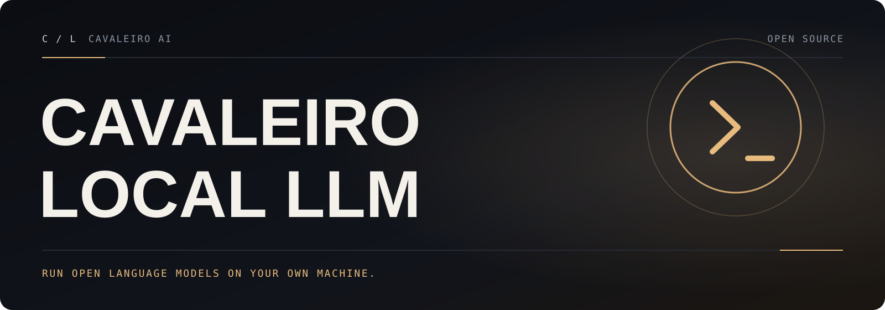

**English** · [Português (Brasil)](README.pt-BR.md)

<a id="top"></a>

<p align="center">
  
</p>

# Cavaleiro Local LLM

**Run open models on your own machine, with a local REST API that works with the tools you already use.**

Cavaleiro Local LLM is maintained by [Cavaleiro AI](https://github.com/cavaleiro-ai). It keeps the `ollama` command, the REST API, and the model format unchanged, so existing clients and integrations keep working, and adds verified fixes for crashes, Windows behavior, and input handling — each with a regression test. See [What Cavaleiro Local LLM adds](#what-cavaleiro-local-llm-adds).

## Contents

- [Install](#install)
- [Get started](#get-started)
- [REST API](#rest-api)
- [Supported backends](#supported-backends)
- [Documentation](#documentation)
- [What Cavaleiro Local LLM adds](#what-cavaleiro-local-llm-adds)
- [Compatibility](#compatibility)
- [License](#license)

## Install

Cavaleiro Local LLM is distributed as source code. The installers at ollama.com (`install.sh`, `install.ps1`, `OllamaSetup.exe`, `Ollama.dmg`) and the `ollama/ollama` Docker image install the original project, not Cavaleiro Local LLM.

### Prerequisites

- [Go](https://go.dev/doc/install) (the version in `go.mod`)
- [CMake](https://cmake.org/download/) 3.24 or newer
- A C/C++ compiler: Clang on macOS, Visual Studio 2022 C++ tools on Windows, or GCC/Clang on Linux
- [Ninja](https://github.com/ninja-build/ninja/releases) in `PATH` is recommended, especially on Windows

### Build from source

```shell
git clone https://github.com/cavaleiro-ai/cavaleiro-local-llm.git
cd cavaleiro-local-llm
cmake -B build .
cmake --build build --parallel 8
./ollama serve
```

This builds the `ollama` binary at the repository root and the native runtime (llama.cpp's `llama-server`, and MLX on Apple Silicon) under `build/lib/ollama`. On macOS arm64 it builds Metal inference; on other platforms it builds CPU inference unless you select GPU backends:

```shell
cmake -B build . -DOLLAMA_LLAMA_BACKENDS="cuda_v13;vulkan"
```

Supported backend values are `cuda_v12`, `cuda_v13`, `rocm_v7_1`, `rocm_v7_2`, `vulkan`, `cuda_jetpack5`, and `cuda_jetpack6`. Platform notes (Windows Developer PowerShell, Vulkan SDK, ROCm, MLX) are in [docs/development.md](docs/development.md). A step-by-step guide in Portuguese for Windows, macOS, and Linux is in [docs/cavaleiro/GUIA-PT-BR.md](docs/cavaleiro/GUIA-PT-BR.md).

To install into a standard prefix layout:

```shell
cmake --install build --prefix /path/to/install
```

### Docker

```shell
docker build -t cavaleiro-local-llm .
docker run -d -v ollama:/root/.ollama -p 11434:11434 --name cavaleiro-local-llm cavaleiro-local-llm
```

For ROCm, add `--build-arg FLAVOR=rocm` to the build.

### Libraries

The `ollama` client libraries for [Python](https://pypi.org/project/ollama/) and [JavaScript](https://www.npmjs.com/package/ollama) work with this server, as do other clients of the same REST API.

## Get started

Start the server, then run a model in another terminal:

```shell
ollama serve
ollama run gemma4
```

`ollama` with no arguments opens an interactive menu to run a model or connect an integration. To launch a specific integration such as [Claude Code](docs/integrations/claude-code.mdx), [Codex](docs/integrations/codex.mdx), [OpenCode](docs/integrations/opencode.mdx), or [OpenClaw](docs/integrations/openclaw.mdx):

```shell
ollama launch claude
```

Models are pulled from the public model library at [ollama.com/library](https://ollama.com/library). See the [quickstart](docs/quickstart.mdx) and the [CLI reference](docs/cli.mdx) for more.

## REST API

The server exposes a REST API on `http://localhost:11434`:

```shell
curl http://localhost:11434/api/chat -d '{
  "model": "gemma4",
  "messages": [{
    "role": "user",
    "content": "Why is the sky blue?"
  }],
  "stream": false
}'
```

### Python

```shell
pip install ollama
```

```python
from ollama import chat

response = chat(model='gemma4', messages=[
  {
    'role': 'user',
    'content': 'Why is the sky blue?',
  },
])
print(response.message.content)
```

### JavaScript

```shell
npm i ollama
```

```javascript
import ollama from "ollama";

const response = await ollama.chat({
  model: "gemma4",
  messages: [{ role: "user", content: "Why is the sky blue?" }],
});
console.log(response.message.content);
```

OpenAI- and Anthropic-compatible endpoints are also available: see [OpenAI compatibility](docs/api/openai-compatibility.mdx) and [Anthropic compatibility](docs/api/anthropic-compatibility.mdx). The full reference is in [docs/api.md](docs/api.md).

## Supported backends

- [llama.cpp](https://github.com/ggml-org/llama.cpp) for GGUF models.
- [MLX](https://github.com/ml-explore/mlx) for safetensors models (default on Apple Silicon; CUDA builds are optional).

## Documentation

- [CLI reference](docs/cli.mdx)
- [REST API reference](docs/api.md)
- [Importing models](docs/import.mdx)
- [Modelfile reference](docs/modelfile.mdx)
- [FAQ](docs/faq.mdx) and [troubleshooting](docs/troubleshooting.mdx)
- [Building from source](docs/development.md)
- [Community integrations](docs/community-integrations.md) — chat apps, editors, SDKs, and frameworks that use this REST API
- [Engineering notes](docs/cavaleiro/ENGINEERING.md) — architecture map, test baseline, and every change in this fork
- [Guia completo em português](docs/cavaleiro/GUIA-PT-BR.md)

The `docs/` folder holds the user manuals (in English). Installers, cloud models, web search, and accounts described there are services of ollama.com, not of this project; everything else matches this project except for the changes in the [changelog](CHANGELOG.md).

<a id="whats-new"></a>

## What Cavaleiro Local LLM adds

Everything in the original project at commit `8be580a`, plus ([full changelog](CHANGELOG.md)):

- **No more startup crash from `OLLAMA_ORIGINS="a, b"`.** Spaces and empty entries are ignored instead of panicking the server (original issue #18011).
- **Hardened registry authentication parsing.** A malformed `WWW-Authenticate` header from a registry can no longer crash the server (original issue #17034).
- **CLI never panics on short digests.** `ollama list`, `ollama ps`, `ollama create`, and `ollama push` handle any digest length and missing progress messages (original issue #14250).
- **Reliable error reporting in the Go API client.** Error responses without a body, such as a `502` from a proxy, are reported instead of being treated as success; blank keep-alive lines are ignored.
- **Better on Windows.** `FROM ~\models\model.gguf` works in Modelfiles, and process detection no longer panics on machines with more than 512 processes and is more than 100x faster.
- **A safe fork.** Release, signing, and Docker publishing workflows are [disabled](.github/workflows-disabled/README.md) until you configure your own identity; community files, issue forms, and Portuguese documentation are included.

<a id="compatibility"></a>

## Compatibility

Cavaleiro Local LLM renames the project, not its identifiers, so existing scripts, clients, and integrations keep working:

| What | Value (unchanged) |
|---|---|
| Command | `ollama` (`ollama serve`, `ollama run`, …) |
| Go module path | `github.com/ollama/ollama` |
| Environment variables | `OLLAMA_HOST`, `OLLAMA_MODELS`, `OLLAMA_ORIGINS`, `OLLAMA_KEEP_ALIVE`, and the rest of `OLLAMA_*` |
| REST API | `/api/*`, plus the OpenAI (`/v1/*`) and Anthropic (`/v1/messages`) compatible endpoints |
| Default address | `127.0.0.1:11434` |
| Data directory | `~/.ollama` (models, keys, `server.json`) |
| Model library and registry | `ollama.com` / `registry.ollama.ai` |
| Desktop app and in-product branding | unchanged (the original project's name) |

**Network services of the original project.** Some features call ollama.com: `ollama pull`/`push` use its registry; cloud models, web search, and sign-in use ollama.com; the server refreshes model recommendations from ollama.com unless cloud features are off. Set `OLLAMA_NO_CLOUD=1` (or `"disable_ollama_cloud": true` in `~/.ollama/server.json`) to turn off cloud features. The server does not include usage telemetry, and this project adds none. The desktop app's auto-updater checks ollama.com and installs releases of the **original project**; disable automatic updates in the app settings if you run a build of this project.

## License

Based on Ollama · MIT License · see [LICENSE](LICENSE). Not affiliated with the original project.

<p align="center">
  <a href="#top">Back to top ↑</a>
</p>
